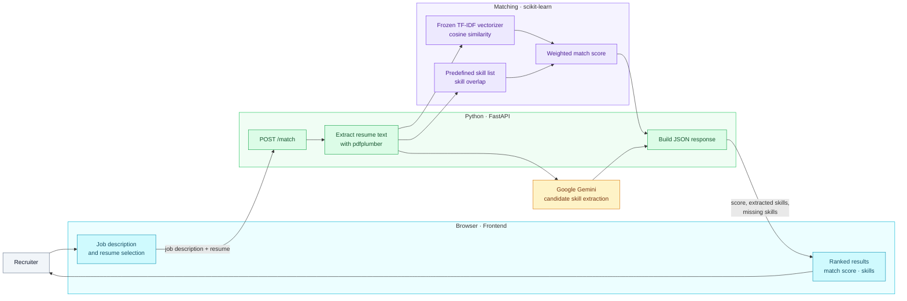

<div align="center">

# Resume Matcher

### Find the resumes that align most closely with a job description.

An explainable resume-ranking demo that combines technical-skill overlap with TF-IDF text similarity, then surfaces missing skills and an overall match score.

<br />


</div>

---

## Overview

Enter a job description, upload resumes, and compare the resulting match scores. The interface sorts candidates from highest to lowest score and displays detected skills and skills missing from each resume.

The project has three main parts:

| Part | What it does |
| --- | --- |
| **Frontend** | Static HTML, CSS, and JavaScript interface for entering a job description, selecting files, and viewing ranked results |
| **Backend API** | FastAPI `/match` endpoint that extracts resume text, runs matching, and returns a JSON result |
| **Matching and extraction** | A frozen scikit-learn TF-IDF vectorizer and predefined skill list produce the match score; Google Gemini extracts candidate skills for display |

## Tech stack

<div align="center">

| Layer | Technologies |
| :--- | :--- |
| **UI** |     |
| **API** |   |
| **Matching** |    |
| **Resume parsing** |  |

</div>

## System architecture



### Match score

The backend combines two signals:

```text
final_score = 0.4 × cosine_similarity + 0.6 × skill_overlap
match_percentage = final_score × 100
```

- **Cosine similarity** compares normalized job-description and resume text transformed by the saved TF-IDF vectorizer.
- **Skill overlap** compares skills found in the job description with skills found in the resume. Its overlap score is the fraction of job-description skills found in the resume.
- **Missing skills** are the job-description skills that were not found in the resume.

The score is a relative matching signal, **not** a probability of success or a hiring recommendation.

## Repository layout

```text
.
├── backend/
│   ├── main.py                  # FastAPI app and /match endpoint
│   ├── requirements.txt         # API dependencies
│   └── ML/
│       ├── ml_logic.py          # TF-IDF, skill extraction, and scoring
│       ├── tfidf_vectorizer.pkl # Pre-trained vectorizer used for matching
│       ├── test_matcher.py      # Sample matcher run
│       └── data/                # Example job descriptions and resumes
└── frontend/
    ├── index.html               # App page
    ├── app.js                   # Upload flow and ranked results
    └── style.css                # UI styles
```

## Getting started

### 1. Start the backend

From the repository root, create and activate a virtual environment, then install the backend dependencies:

```powershell
cd backend
python -m venv .venv
.\.venv\Scripts\Activate.ps1
pip install -r requirements.txt
```

Create `backend/.env` and add a Google Gemini API key:

```env
GEMINI_API_KEY=your_api_key
```

Start the API from the `backend` directory:

```powershell
uvicorn main:app --reload --host 127.0.0.1 --port 8000
```

The API root is `http://127.0.0.1:8000/`; interactive API documentation is at `http://127.0.0.1:8000/docs`.

### 2. Open the frontend

In a second terminal, serve the frontend directory:

```powershell
cd frontend
python -m http.server 5500
```

Open `http://127.0.0.1:5500` in a browser. The frontend currently sends requests to the deployed API URL `https://resume-jd-matching-ml.onrender.com/match`. To use the local backend instead, change the URL in [`frontend/app.js`](frontend/app.js) to `http://127.0.0.1:8000/match`.

### 3. Run the matcher example

The sample matcher script uses the bundled vectorizer and example texts:

```powershell
cd backend\ML
python test_matcher.py
```

## API

`POST /match` accepts multipart form data:

| Field | Type | Description |
| --- | --- | --- |
| `job_description` | string | Job description to compare against |
| `file` | file | Resume PDF |

On success, the response contains `filename` and `data` fields with `match_percentage`, `extracted_skills`, and `missing_skills`. The frontend sends each selected resume in a separate request, then sorts successful results by score.

## Current limitations

- **File-type mismatch:** the frontend file picker currently accepts `.txt` files, but the backend extracts text from PDFs. Use a PDF when calling the API directly; align the frontend file picker with the backend before using the complete browser flow.
- **Local API URL:** the frontend defaults to the deployed Render API. Change the URL in `frontend/app.js` to use a locally running backend.
- **Gemini configuration:** skill extraction requires `GEMINI_API_KEY`. If Gemini returns no skills or errors, the backend falls back to the skills found by the matcher.
- **Text-based PDFs:** image-only or scanned PDFs may not yield extractable text.
- **Matching limitations:** TF-IDF is lexical rather than deeply semantic, and skill detection relies on a predefined vocabulary.
- **Privacy:** resume text is sent to the configured backend, and the backend sends resume text to Gemini for skill extraction. Do not upload sensitive documents unless this processing is appropriate for your use case.
- **Hiring use:** scores can reflect wording and data limitations. Use the results only as decision-support and review resumes directly; do not use the score as an automated hiring decision.

## Further reading

- [ML approach and limitations](backend/ML/README.md)
- [Backend API](backend/main.py)
- [Matching logic](backend/ML/ml_logic.py)
